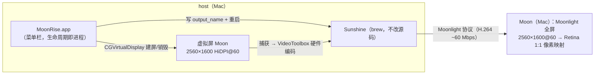

# MoonRise

把另一台 Mac（Moon）变成本机（host）的扩展屏，充分利用 Moon 的 Retina 面板（1:1 像素映射）。

host 上由菜单栏 App 创建一块 HiDPI 虚拟屏幕并自动联动官方 Sunshine；Moon 端 Moonlight 全屏显示该虚拟屏。

设计与实施记录：Plans/implementation-plan.md（中文）。

## 架构



- 生命周期即进程：App 启动建屏、退出销毁（约 0.2–0.4s）。
- 虚拟屏名 "Moon"，默认 2560×1600 HiDPI@60，菜单可改分辨率（预设 + 自定义）。
- HiDPI 实现原理：声明主模式（2560×1600）+ 逻辑模式（1280×800），macOS 的 HiDPI 倍化合成会生成"1280×800（像素 2560×1600）"的全倍 Retina 模式。
- 身份稳定：vendor/product/serial 由（名称+像素尺寸）FNV-1a 推导，跨重启不变——位置与分辨率记忆因此可用。
- 音频不处理：菜单默认勾选「禁用音频串流」（写 Sunshine 的 stream_audio = disabled，采集侧直接关闭）；host 本地照常出声。
- Sunshine 托管：由 MoonRise 的 LaunchAgent（com.moonrise.sunshine）运行，退出 App 连带停止；进程由 launchd 拉起，屏幕捕获权限归属稳定在 sunshine 二进制——重建/重装 MoonRise 不需重新授权。托盘图标默认隐藏（QT_QPA_PLATFORM=minimal）。

## host 安装（macOS 13+，Apple Silicon 实测 macOS 27）

1. 如安装了 Duet Display：先禁用其虚拟屏（iPad 等其他用途不受影响）。
2. 安装 Sunshine：
   ```bash
   brew tap lizardbyte/homebrew
   brew install lizardbyte/homebrew/sunshine
   brew pin sunshine   # 避免自动升级打断
   ```
3. 安装 MoonRise.app 后启动它：菜单 → **权限引导…**，按面板指引给 **MoonRise** 授予屏幕捕获类权限（macOS 27 实测在设备控制类面板；与 Duet 所用一致）。Sunshine 以子进程运行，macOS 按责任进程向 MoonRise 收权限——给 sunshine 二进制单独授权无效。输入控制权限在 Moon 需要键鼠控制时同样授予 MoonRise（面板可一键请求）。
4. 构建并安装 App：
   ```bash
   swift build -c release
   scripts/install-app.sh
   open /Applications/MoonRise.app
   ```
   菜单栏出现显示器图标，虚拟屏自动创建，Sunshine 自动同步并重启。
5. 浏览器打开 https://localhost:47990 创建 Sunshine 账号。
6. **开启 Retina**（关键）：系统设置 → 显示器 → 选中 "Moon" → 分辨率选 **1280×800**（“看起来像”）→ 拖到合适位置。macOS 按身份记住，此后自动生效。

## Moon 端安装（MacBook Pro 2015 实测）

1. 安装 moonlight-qt（最新版支持 macOS 11+）。
2. 显示设置保持"默认为此显示器"（1280×800，恰好 2x 整数缩放——像素级清晰的必要条件）。
3. 连接 host（同一局域网，建议 5GHz Wi-Fi 或有线），输入 PIN 配对。
4. 视频设置：分辨率 **2560×1600**、帧率 **60**、编码 **H.264**（Broadwell 无 HEVC 硬解）、码率 **60 Mbps**、全屏；音量 0。
5. 全屏后，屏幕文字应与原生一样锐利（同页 PDF 对比检验）。

## 菜单功能

- 状态行：分辨率 · displayID · Sunshine 同步状态
- 重新开始虚拟屏：销毁 + 重建 + 自动重新同步（约 1–2s）
- 分辨率：预设（2560×1600 / 1920×1200 / 2560×1440 / 1920×1080）+ 自定义（W、H、刷新率 30/60/75/120）
- Sunshine：运行状态行 / 重新同步 output_name / 禁用音频串流（默认勾选）/ 重启 Sunshine / 打开 Web UI
- 诊断…：一键检查私有 API、虚拟屏、Sunshine 安装、output_name 一致性、捕获权限（从日志推断）、Retina 指引、外接显示器清单
- 开机自启（SMAppService，默认关；需先 install-app.sh 装为 App）
- 退出：销毁虚拟屏后退出（无确认）

## 排障

- **Sunshine 报无权限 / 编码器探测失败**：诊断窗口会从日志判断；确认权限后菜单 → Sunshine → 重启 Sunshine。
- **Moonlight 全屏有黑边**：虚拟屏宽高比必须与串流分辨率一致。改分辨率请用本 App 菜单同步改（如 Moonlight 退到 2560×1440 预设，则菜单也选 2560×1440）。
- **Retina 发糊**：确认 Moon 显示设置是"默认为此显示器"（2x 整数缩放）；虚拟屏选中了逻辑模式（如 1280×800）。
- **改分辨率后没有全倍 Retina**：自定义分辨率需为偶数尺寸（逻辑模式 = 一半尺寸）；改完在系统设置重新选一次逻辑模式。
- **两个 Sunshine 冲突**：Sunshine 由 MoonRise 的 LaunchAgent 独占托管（首次启动自动解除 brew services 注册）；不要手动另起实例。
- **/Library/ColorSync/Profiles/Displays 里的 ICC 文件**：每个虚拟屏身份一个，属主 root，属正常副作用，不要手删。
- **App 退出后屏消失**：设计如此（生命周期即进程）；重新打开即恢复。

## 开发

```bash
swift build          # 构建
swift test           # 单测（身份推导、conf 编辑器、规格校验、边界判定）
bash scripts/install-app.sh   # 装为 App
```

- `Sources/VirtualDisplayObjC`：私有 API 薄封装（MRC；运行时类/selector 全量校验，缺失时点名报错，不崩溃）
- `Sources/MoonRiseCore`：规格/身份/控制器、配置、状态、Sunshine 联动
- `Sources/MoonRiseBar`：菜单栏 App
- 路线图：M4 计划把 Sunshine 启动整合为 App 子进程（退出连带停止，替代 brew services 编排）

## 已知限制

- 依赖 CoreGraphics 私有 API（macOS 更新可能失效；App 会以菜单错误状态点名缺失项，不会崩溃）
- 虚拟屏位置不做程序控制（避免"改排列后无法销毁"陷阱），首次手动拖放后由 macOS 记忆
- 分辨率变更 = 销毁重建（约 1–2s），期间该屏上的窗口会暂时回到主屏
