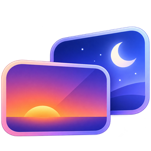

# MoonRise

<p align="center"></p>

[](https://github.com/rexzhang/moonrise)
[](https://github.com/rexzhang/moonrise)
[](https://github.com/rexzhang/moonrise)

仓库：https://github.com/rexzhang/moonrise

把另一台 Mac/iPad（Moon）变成本机（host）的扩展屏，充分利用 Moon 的 Retina 面板（1:1 像素映射）。

MoonRise 是一款菜单栏应用：在 host 上创建 HiDPI 虚拟屏幕（默认 2560×1600@60，可逐屏自定义），每块屏绑定一个由 App 托管的 Sunshine 实例，自动捕获串流；Moon 端用 Moonlight 全屏显示，文字与原生同样锐利。App 在则屏在，退出即销毁全部虚拟屏并停止全部实例。

核心特性：

- HiDPI 虚拟屏：逻辑分辨率 + 像素模式双层声明，Moon 的 Retina 面板 1:1 像素映射，显示锐度与原生屏一致
- 1-N 块扩展屏：逐屏规格（分辨率 / 刷新率 / HiDPI）与启用开关，多台 Moonlight 客户端可同时各连一块屏
- 全托管串流：Sunshine 官方包在 App 内一键获取，全部实例作为子进程运行，无需手动配置
- App 内配对：点「配对…」输入客户端显示的 PIN 即完成，无需登录 Sunshine 管理界面

## 快速开始

前提：host 为 macOS 14+（Apple Silicon / Intel），装有 Xcode 命令行工具；Moon 端另装 moonlight-qt。

Clone 本仓库后，在 host 上执行：

```bash
# 1. 生成自签签名证书（一次性，弹框点"始终信任"）
bash scripts/make-cert.sh --trust

# 2. 编译、签名并安装到 /Applications
bash scripts/install-app.sh

# 3. 启动（菜单栏形态运行）
open /Applications/MoonRise.app
```

首次启动按指引完成四步（详见 docs/install.md）：

1. 获取 Sunshine：自动打开设置「Sunshine」页，点「获取」从 GitHub Releases 下载官方版本（自动验签），完成后屏幕功能解锁
2. 授权：「权限」页允许「屏幕捕获」与「输入控制」两项（授权对象是 MoonRise）
3. Retina 与排列：系统设置 → 显示器 选中 "Moon"，分辨率选 1280×800（"看起来像"），并把排列位置拖到主屏旁——分辨率与位置一起调整，macOS 会记住
4. 连接：Moon 端 moonlight-qt 连接本机 → 输入 PIN 配对 → 分辨率 2560×1600 / 60fps / H.264 / 60 Mbps / 全屏，音量 0

## 文档

| 文档 | 内容 |
|---|---|
| docs/install.md | 安装、首次设置、界面导览、配对、多扩展屏、卸载 |
| docs/troubleshooting.md | 权限、显示、配对、进程、多屏常见问题排障 |
| docs/development.md | 构建、测试、架构与原理、签名阶梯、约束（开发者） |
| Plans/implementation-plan.md | 设计决策与实测结论记录（动 VirtualDisplay 层前必读） |
| Plans/multi-display-spike.md | 多屏与多实例实测结论（动 Sunshine 集成层前必读） |
| AGENTS.md | AI 编码代理的项目规则 |
