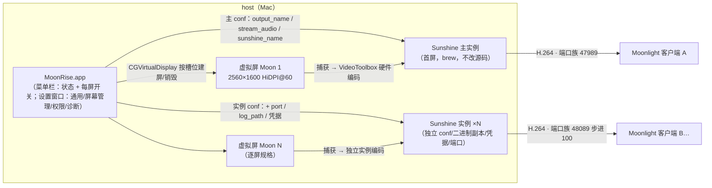
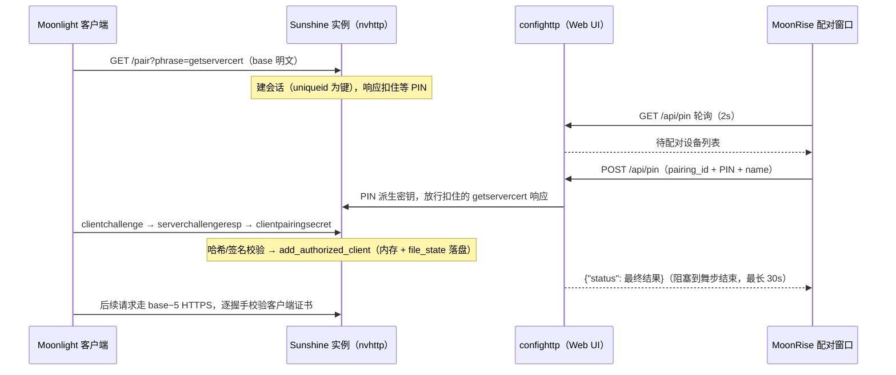

# 架构与原理

MoonRise 在 host（本机 Mac）上用 CoreGraphics 私有 API 创建 HiDPI 虚拟屏幕（多扩展屏：Moon 1…Moon N），每屏绑定一个 Sunshine 实例串流；远程 Moonlight 端全屏显示，Retina 面板 1:1 像素映射。

## 总体架构

- 首屏（Moon 1）绑定用户主 sunshine.conf（默认端口 47989），行为与旧单屏一致，不可删除；第 2..N 屏各绑定 MoonRise 自有 Sunshine 实例（~/.config/moonrise/sunshine-instances/<uuid>/：conf + bin/ 可执行副本 + credentials/ 独立 CA + 日志）。
- 二进制副本独立路径是 macOS 27 的硬要求：同一路径的并发捕获被系统串行化（第二进程永久挂起，spike S7 实测）。
- 可执行副本形态（spike S8）：受管源与实例副本均为官方 .app 整 bundle 拷贝（bin/<源 bundle 名>/）——官方二进制带启动约束，裸拷贝在 bundle 外 exec 即被 SIGKILL。新鲜度以可执行文件 SHA-256 对锚，源升级后刷新。
- 变更经 diff 收敛（DisplayReconcilePlan）：只重建改动屏，保留屏的串流不中断；实例启动/重启串行执行。

## 设计要点

- 生命周期即进程：App 启动按上次开关状态逐屏建屏，退出销毁全部并连带停止全部实例。
- 逐屏规格：名称（自动 Moon N 跳过已用名，可改唯一名）、宽高、刷新率、HiDPI 逐屏配置；名称与端口创建时冻结（改名 = 身份变化 = 记忆重置 + 重建）；删屏编号留洞。
- HiDPI 实现原理：声明主模式（W×H）+ 逻辑模式（W/2×H/2），macOS HiDPI 倍化合成生成全倍 Retina 模式；HiDPI 关闭时只有主模式。
- 身份稳定：vendor/product/serial 由（名称+像素尺寸）FNV-1a 推导（vendor 0x6D6F "mo"、product 0x6F6E "on"，连读 moon），跨重启不变；多屏身份唯一性靠显示名唯一保证。
- 逐屏开关：enabled 持久化，停用 = 停实例+销屏、槽位冻结属性保留；收敛只对已启用屏 diff，停用屏不被守护复活。
- 实例对外名称：实例 conf 的 sunshine_name = 屏幕显示名（主 conf 同样写首屏名），客户端连接后主机名即屏名。
- 音频不处理：全局「禁用音频串流」写主 conf 与全部实例 conf；host 本地照常出声。
- Sunshine 来源与托管：来源唯一 = 受管目录（~/.config/moonrise/sunshine/Sunshine.app，ManagedSunshineStore 手动获取——官方 GitHub release、本机架构资产、验签 LizardByte TeamID、原子换装；支持的最低版本 v2026.1112，其 ScreenCaptureKit 捕获修复了 macOS 27 的 AVFoundation 错绑与停滞，spike S8）。未获取 = 锁定态：不建屏/不启实例/不同步 conf，菜单与屏幕管理页引导设置窗口 Sunshine 页。首屏与扩展屏实例均为子进程独占托管（退出连带停止，异常退避重启，孤儿接管）；扩展屏实例端口 48089 起步进 100 冻结；实例启动/重启串行化。托盘抑制走 conf 键 system_tray = disabled（上游原生，全实例生效）。
- 设置存储：ConfigStore（@Observable，UserDefaults 单键 "appConfig" JSON blob）为全部设置的单一来源；所有修改经 store.mutate 收口（改 → 持久化 → 通知）；旧 config.json 首启自动导入并归档 .imported。state.json 是运行态事实不是设置，不经 ConfigStore。
- 外部实例清杀按进程归属判定（ppid + 托管家族集合），绝不按二进制路径——扩展屏副本与源同内容属正常形态。
- 串流状态：逐实例日志尾随（log_path 分流）识别会话开始/结束，菜单栏每屏一行显示开关图标与状态词（串流中 / 空闲 / 未启用 / 离线）；看门狗 30s 对账兜底。
- 客户端发现：Moonlight 按 IP 去重，自动发现只认首实例——扩展屏以手动添加 IP:端口 为主路径（本机 IP 集中显示在设置屏幕页顶部）；逐实例 PIN 配对（共享 CA 不免配对，spike S2 实测）。

## 配对与凭据持久化

每个 Sunshine 实例（含首屏）独立配对、独立凭据。端口族以实例冻结端口 base 为基准（首屏 base=47989，扩展屏 48089 起步进 100）：

- base：nvhttp 明文 HTTP——Moonlight 配对舞步（/pair）走这里
- base−5：nvhttp HTTPS——配对后的所有客户端请求在此做 TLS 客户端证书校验
- base+1：Web UI（confighttp）——MoonRise 配对窗口的 API 通道
- base+21：RTSP——串流会话

配对时序（PIN 窗口路径，Mermaid）：

机制要点：

- POST /api/pin 是阻塞语义：返回的 status 即最终配对结果；配对成功与失败都会移除会话——"会话消失"不能作为成功判据，权威判定 = 响应 status 或 GET /api/clients/list。
- GET /api/pin 只列 phase=NONE 的会话；会话 5 分钟过期；/unpair 端点已从 nvhttp 移除（客户端发 /unpair 落 404，无副作用）。
- 同一证书在 named_devices 存多条时，Sunshine 判歧义直接拒绝（出示正确证书也过不了）——配对状态正常落盘后不会积累。
- 实例 conf 的 file_state（配对状态）与 credentials_file（Web UI 凭据存储）都指向实例 credentials/state.json；缺 file_state 会落到全局默认路径（~/.config/sunshine/sunshine_state.json），与主实例互相污染。credentials_file 缺省取 file_state 值。
- state.json 双用途：顶层 username/salt/password 是 Web UI 凭据哈希（confighttp 启动读取），root 是配对状态（nvhttp 写回时保留顶层字段）。清掉顶层字段 = Web 凭据归零、全部 /api 请求 302 回 /welcome。
- Web 凭据预置：实例创建后凭据为空，MoonRise 调 POST /api/password 写入随机凭据并存 credentials/webui.json（0600）；配对窗口开窗时从磁盘加载，重置凭据后需重开窗口。首屏凭据归用户，MoonRise 不接管（配对走 Web UI 引导）。
- 客户端证书不一致：客户端在配对舞步里上交的证书必须与它后续 TLS 握手出示的证书一致，否则服务端拒绝（"Client certificate identity is not enabled"）。旧版 moonlight-iOS 存在两者不一致的缺陷——重装客户端可解（钥匙串身份随重装重新生成）。

## 权限机制（macOS 27 实测）

MoonRise 需要两项权限，授权对象都是 MoonRise 自身（com.rexzhang.moonrise）：

- 屏幕捕获（kTCCServiceScreenCapture）：Sunshine 以子进程运行，macOS 按责任进程（responsible process）向 MoonRise 收权限——给 sunshine 二进制单独授权无效。
- 输入控制（辅助功能，AXIsProcessTrusted）：Moon 端键鼠控制需要。

机制要点：

- TCC 条目注册必须由 MoonRise 本进程调用官方 API（CGRequestScreenCaptureAccess / AXIsProcessTrustedWithOptions）完成：子进程触发的检查只弹窗、不写系统设置条目。
- 授权持久化依赖稳定签名：ad-hoc 签名每次重建 cdhash 变化，tccd 拒绝持久化授权 → 必须用 MoonRiseDev 自签证书（或 Developer ID）签名。见 docs/development.md 的签名阶梯。
- 权限状态由「权限引导…」面板实时监控（屏幕捕获 preflight / 输入控制 AXIsProcessTrusted / Sunshine 进程 / 编码探测日志四源），权限缺失时启动自动弹出。
- 实测参考：Duet（com.kairos.duetMac）走 kTCCServiceRemoteDesktop（无 ScreenCapture 条目）也可捕获；MoonRise 授权后若仍有问题可研究该路径。

## 私有 API 调用序列

虚拟屏使用 CoreGraphics 私有 ObjC 类（CGVirtualDisplayDescriptor / CGVirtualDisplay / CGVirtualDisplaySettings / CGVirtualDisplayMode，dyld 共享缓存内，无需 kext 与 TCC 权限）：

- Descriptor: alloc/init → setName: → setMaxPixelsWide:/setMaxPixelsHigh: → setSizeInMillimeters: → setVendorID:/setProductID:/setSerialNum: → setQueue:（不装 setTerminationHandler:）
- Display: alloc/initWithDescriptor: → Settings: setModes: + setHiDPI:（uint32，非 BOOL）→ applySettings: → displayID
- 销毁：release 恰好一次 → 轮询活动列表消失（~0.3s）
- 发消息前必须 objc_getClass + class_getInstanceMethod 全量校验（20 个 selector），缺失时点名报错、不崩溃

完整设计与实测结论见 Plans/implementation-plan.md。
