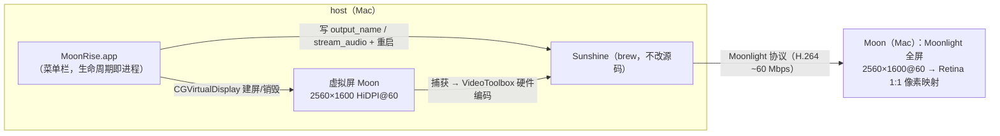

# 架构与原理

MoonRise 在 host（本机 Mac）上用 CoreGraphics 私有 API 创建一块 HiDPI 虚拟屏幕，自动联动官方 Sunshine 捕获串流；远程 Mac（Moon）端由 Moonlight 全屏显示，Retina 面板 1:1 像素映射。

## 总体架构

## 设计要点

- 生命周期即进程：App 启动建屏、退出销毁（约 0.2–0.4s）并连带停止 Sunshine。
- 虚拟屏名 "Moon"，默认 2560×1600 HiDPI@60，菜单可改分辨率（预设 + 自定义）。
- HiDPI 实现原理：声明主模式（2560×1600）+ 逻辑模式（1280×800），macOS 的 HiDPI 倍化合成会生成“1280×800（像素 2560×1600）”的全倍 Retina 模式。
- 身份稳定：vendor/product/serial 由（名称+像素尺寸）FNV-1a 推导（vendor 0x6D6F "mo"、product 0x6F6E "on"，连读 moon），跨重启不变——位置与分辨率记忆因此可用。
- 音频不处理：菜单默认勾选「禁用音频串流」（写 Sunshine 的 stream_audio = disabled，采集侧直接关闭）；host 本地照常出声。
- Sunshine 托管（managed 模式）：由 MoonRise 以子进程独占运行（opt 稳定路径启动，brew 升级自动跟随），退出 App 连带停止；异常退出退避重启（5s→60s 封顶）；Sunshine 自我 fork 的孤儿实例自动接管；首次启动解除 brew services 注册，防止双实例。托盘图标默认隐藏（QT_QPA_PLATFORM=minimal）。

## 权限机制（macOS 27 实测）

MoonRise 需要两项权限，授权对象都是 MoonRise 自身（com.rexzhang.moonrise）：

- 屏幕捕获（kTCCServiceScreenCapture）：Sunshine 以子进程运行，macOS 按责任进程（responsible process）向 MoonRise 收权限——给 sunshine 二进制单独授权无效。
- 输入控制（辅助功能，AXIsProcessTrusted）：Moon 端键鼠控制需要。

机制要点：

- TCC 条目注册必须由 MoonRise 本进程调用官方 API（CGRequestScreenCaptureAccess / AXIsProcessTrustedWithOptions）完成：子进程触发的检查只弹窗、不写系统设置条目。
- 授权持久化依赖稳定签名：ad-hoc 签名每次重建 cdhash 变化，tccd 拒绝持久化授权 → 必须用 MoonRiseDev 自签证书（或 Developer ID）签名。见 docs/development.md 的签名阶梯。
- 权限状态由「权限引导…」面板实时监控（屏幕捕获 preflight / 输入控制 AXIsProcessTrusted / Sunshine 进程 / 编码探测日志四源），权限缺失时启动自动弹出。
- 实测参考：Duet（com.kairos.duetMac）走 kTCCServiceRemoteDesktop（无 ScreenCapture 条目）也可捕获；MoonRise 授权后若仍有问题可研究该路径。

## 私有 API 调用序列

虚拟屏使用 CoreGraphics 私有 ObjC 类（CGVirtualDisplayDescriptor / CGVirtualDisplay / CGVirtualDisplaySettings / CGVirtualDisplayMode，dyld 共享缓存内，无需 kext 与 TCC 权限）：

- Descriptor: alloc/init → setName: → setMaxPixelsWide:/setMaxPixelsHigh: → setSizeInMillimeters: → setVendorID:/setProductID:/setSerialNum: → setQueue:（不装 setTerminationHandler:）
- Display: alloc/initWithDescriptor: → Settings: setModes: + setHiDPI:（uint32，非 BOOL）→ applySettings: → displayID
- 销毁：release 恰好一次 → 轮询活动列表消失（~0.3s）
- 发消息前必须 objc_getClass + class_getInstanceMethod 全量校验（20 个 selector），缺失时点名报错、不崩溃

完整设计与实测结论见 Plans/implementation-plan.md。
